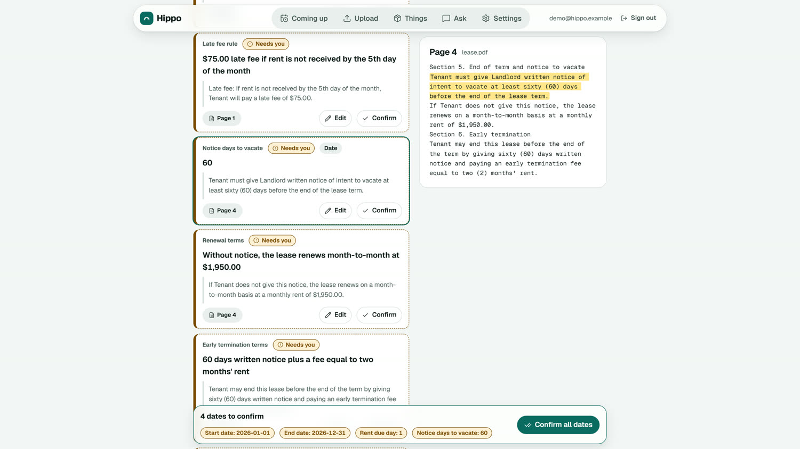
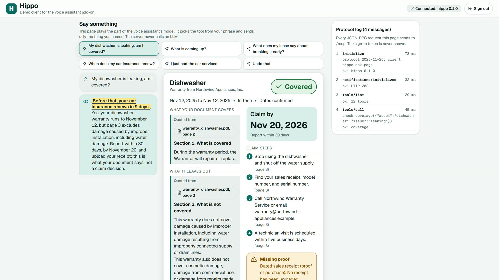
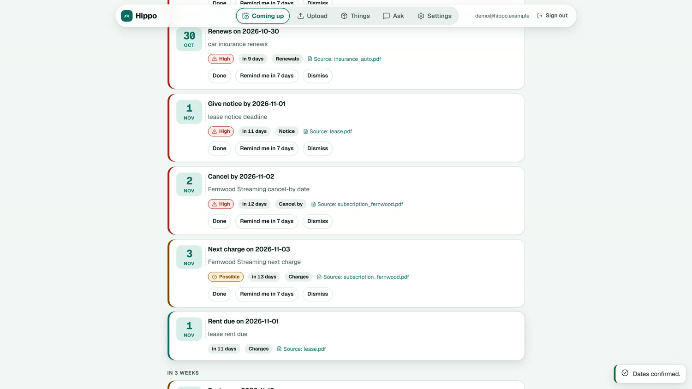

# Hippo

**An Alexa+ app that gives your papers a memory.**

Hippo turns the paperwork a household never reads twice (warranties, insurance, a lease, subscriptions, recall notices) into dated obligations, and watches them while nobody is talking. You drop documents into a web app. Then you ask Alexa, and Hippo answers from your own documents and cites the page.

[Live demo](https://hippo-production-f9ae.up.railway.app) | [Demo video](https://youtu.be/OxnZ7RSM9_Y) | [Landing page](https://hippo-landing-kranthisai07s-projects.vercel.app/welcome) | [Run it in two minutes](#run-the-demo) | [Honest limits](#honest-limits)

> **Status: working build, Alexa+ hackathon (Build, Ship, Shape).** Everything runs locally against a synthetic household, with 3253 passing tests (3524 in CI, which adds the DynamoDB Local suite). Only a synthetic data demo server is deployed ([docs/DEPLOY.md](docs/DEPLOY.md)); the AWS design in `infra/` is not. Alexa+ developer tools are partner only, so the voice demo is a web page (`/ask`) that acts as a real MCP client against the same server. A live Bedrock extraction never ran, because the account's daily token quotas were zero. [What is real and what is not](#what-is-real-and-what-is-not) is the honest list.

## Why

The cost of household paperwork shows up as missed deadlines: a lease notice window that closed, a warranty that ran out three weeks before the dishwasher leaked, a subscription that renewed at full price, a recalled product still in use.

Alexa+ can already store notes and answer questions about documents you give it. It does not turn those documents into dated obligations, join them (this item, this receipt, this warranty, this exclusion), or watch them in the background. That gap is the product.

## The three moments

**1. Upload to deadline.** Drop a lease PDF into the web app. Seconds later it shows "Give notice by Nov 1" with the quoted clause and the page. Nothing alerts you until you confirm the date.



**2. Coverage by voice.** "Alexa, my dishwasher is leaking. Am I covered?" The answer: yes, in warranty until Nov 12, but water damage from improper installation is excluded (page 3). It lists the claim steps, the claim by date, and the receipt you have not uploaded.



**3. Proactive catch.** The next voice question starts with one sentence: "Before that, your car insurance renews in 9 days." A daily job checks recall data against what you own (the demo uses saved real CPSC and NHTSA responses; it has never run against the live APIs) and builds an email digest.



## Run the demo

Needs Node 22.13 or newer and pnpm (the version is pinned in `package.json`). No AWS account, no Docker and no keys: everything runs on your machine with a synthetic household.

```bash
git clone https://github.com/Kranthisai07/Hippo.git && cd Hippo
pnpm install --frozen-lockfile
pnpm dev        # terminal 1: API, OAuth and MCP server on http://localhost:8787 (in memory, seeded from the fixtures)
pnpm dev:web    # terminal 2: the web app on http://localhost:5173
```

Open http://localhost:5173 (use `localhost`, not `127.0.0.1`) and press the demo sign in button. The public landing page is at http://localhost:5173/welcome.

1. **Upload to deadline.** Settings, delete `lease.pdf` (it is pre loaded), then Upload and drop `fixtures/docs/lease.pdf`. Coming up shows "Give notice by 2026-11-01" waiting for you. Open "Review and confirm", click the page 4 quote, press "Confirm all dates": only now does it become a reminder.
2. **Coverage by voice.** Open http://localhost:5173/ask, press "Sign in as the demo account" and click "My dishwasher is leaking, am I covered?". This page is a real MCP client (OAuth with PKCE, then `tools/call` over Streamable HTTP). It shows the spoken answer and the Coverage card.
3. **Proactive catch.** The first answer after the server starts begins with "Before that, your car insurance renews in 9 days." Click "What is coming up?" for the Coming Up and Recall cards. `pnpm daily:run` prints the daily digest (a dry run).

`pnpm --filter @hippo/api demo` walks the same moments in a terminal. The server clock is pinned to 2026-10-21 so the dates in the fixtures are always "in the window"; set `HIPPO_TODAY=now` to use the real date. The demo reads only the sample documents in `fixtures/docs`.

<details>
<summary>Tests, typecheck and rebuilding the fixtures</summary>

Needs Python 3.9 or newer for the fixture generator.

```bash
pnpm test && pnpm typecheck   # obligation-kit 614, core 1054 (1325 in CI with DynamoDB Local), auth 307, api 734, workers 366, web 126, extension 28, infra 25
pip install reportlab pypdf pillow && python fixtures/tools/generate.py
```

The last command rebuilds the PDFs, the photo and the expected JSON, and fails if any expected source quote is missing from its cited page. The phone-photo JPG is drawn with Arial when found, so on another machine it will differ slightly from the committed copy. The quote check is unaffected.

The browser tests need their browser once: `pnpm --filter @hippo/web exec playwright install chromium`, then `pnpm --filter @hippo/web test:e2e` with ports 8787 and 5173 free.

A static copy of the landing page can be hosted: build with `VITE_HOSTED=1 pnpm --filter @hippo/web build` and on Vercel with the project root set to `apps/web`, which reads `apps/web/vercel.json` (install, build and rewrite settings). The static page has no API behind it, so its demo buttons open the live demo server ([docs/DEPLOY.md](docs/DEPLOY.md)).

</details>

## The Chrome extension

Most subscription paperwork is a web page, not a PDF. The extension saves one: open a billing page, a receipt or a checkout, click the Hippo button, press Save. Hippo pulls out the vendor, price, cycle and dates, each with the words it came from, and you confirm them on the same Review screen as an upload. Nothing alerts until you do. The Subscriptions page and the popup list everything Hippo knows about, with a monthly total of what you have confirmed.

It reads only the page you choose, only after your click: the visible text, with long numbers masked, and the site name, never the full address. There is no background reading and no email or bank access. Reading uses fixed rules with no model, so it costs nothing and handles common layouts only. A page with no subscription is not kept. Details are in [apps/extension/README.md](apps/extension/README.md).

Status: run it locally as an unpacked extension. It is not in the Chrome Web Store, and saving is off on the public demo server, because everyone there shares one household.

## Four rules everything follows

- **No unconfirmed alarms.** A date a model extracted creates no alert until a person confirms it in the web app.
- **The voice path is fast and dumb.** Tool handlers make no LLM calls and no outbound HTTP. All reading happens at upload time. Document questions use in-process keyword retrieval, and Alexa+ writes the spoken answer from the clauses we return. Target round trip: under 500 ms (`pnpm test:latency` measured p95 under 150 ms locally).
- **Cite or do not claim.** Any answer from a document names the document and the page. Any extracted field whose quote is not on the page it cites is dropped.
- **Documents are hostile input.** Text inside an upload is data, never instructions. Policy and account numbers are masked to the last four, and the household always comes from the sign in token, never from a tool argument.

## How it is built

```
 Browser ──► Web app (upload, review, confirm, Coming Up)
                │ HTTPS, one OAuth login
 Alexa+ ──► api  /mcp  tools, no LLM, no outbound HTTP
                │  /api  web JSON
                │  /oauth
                ▼
           repository (memory, or DynamoDB) ◄── daily job: deadlines, alerts, recall check, email digest
                ▲
                └──── ingest worker: text per page, extraction,
                      quote check, clause index
```

This is the target design. It runs locally today; the CDK stack for the AWS version is synthesized and tested but has never been deployed. Details are in [docs/ARCHITECTURE.md](docs/ARCHITECTURE.md), [docs/PRIVACY.md](docs/PRIVACY.md) and [docs/WEB_API.md](docs/WEB_API.md).

## Repository layout

| Path | What it is |
| :--- | :--- |
| `apps/api` | The MCP server (nine tools), the OAuth endpoints and the web JSON API, on Hono. Data is in memory, seeded from the fixtures |
| `apps/web` | The React web app (upload, review, Coming up, Things, Settings), the public landing page and the `/ask` demo MCP client |
| `apps/extension` | The Chrome extension (Manifest V3): save a subscription page you are looking at, for review in the web app |
| `apps/workers` | The ingest pipeline and the daily job (deadline alerts, recall radar, digest email) |
| `packages/obligation-kit` | Deadline engine, extraction schemas, source quote check and CPSC and NHTSA matchers. One dependency (zod); network access only through an injected fetch |
| `packages/core` | Asset resolver and linking, the repository (memory and DynamoDB), clause index, PDF page text, digest builder |
| `packages/auth` | OAuth 2.1 server, sessions and tokens |
| `infra` | CDK stack. Synthesized and template tested, never deployed |
| `fixtures` | Synthetic demo documents, expected extractions and saved real recall responses |
| `docs` | Architecture, privacy, web API, tool results, demo script, verified docs check, product feedback and friction log |
| `.github/workflows`, `docker-compose.yml`, `scripts` | CI, DynamoDB Local for the repository tests, and stubs for commands that are not built |

## What is real and what is not

| Works today | Not done |
| :--- | :--- |
| MCP server with 9 tools and 3 card button tools over stateless Streamable HTTP, OAuth 2.1 with PKCE | Running on a real Alexa+ device (developer tools are partner only) |
| Deadline engine, source quote check, asset resolver and linking, recall matchers | A live Bedrock extraction (the adapter exists and has only run against fakes) |
| PDF page text extraction with size, page and time limits | OCR through our own Textract adapter (one real page was read through the AWS CLI) |
| Web JSON API, web app, `/ask` demo client with Coverage, Coming up and Recall cards | The MCP Apps host bridge (the cards are plain React) |
| Daily job, digest builder and the SES adapter: one real digest was sent on 2026-10-21 from a sandbox account to a verified address | Any AWS deployment. DynamoDB is verified only against DynamoDB Local; sessions and auth state are in memory |
| Ingest pipeline in fixture mode (8 of 8 dates and 58 of 58 fields match the expected files) | Reading any document other than the demo documents by default |
| Chrome extension against a local server: sign in, save a page, confirm, in real Chrome | The toolbar click (the automated run used a test copy that opens the popup as a tab), any store release, saving on a public server |

<details>
<summary>Per part detail and test counts</summary>

| Part | State |
| :--- | :--- |
| Demo fixtures: 5 synthetic PDFs and a phone-photo JPG, fictional companies only | Done, in [fixtures/](fixtures/README.md) |
| Hand-written expected extractions with page numbers and source quotes | Done, every quote checked against its page by `generate.py` |
| Real recall data: CPSC 26530 (baby bottles, matched by UPC) and NHTSA campaigns for a 2021 Honda CR-V | Done, raw API responses saved |
| Deadline engine (`packages/obligation-kit`) | Done, 160 tests |
| Source quote check (`packages/obligation-kit`): drops any extracted field whose quote is not on the page it cites | Done, 71 tests |
| Asset and agreement resolver (`packages/core`): turns "my fridge" into one asset, or asks | Done, 89 tests |
| Asset linking (`packages/core`): matches a document's brand, model and serial, or a vehicle, to an owned asset, or proposes a new one | Done, 61 tests |
| Recall matchers (`packages/obligation-kit`): CPSC and NHTSA parsers and matchers. `high` only on a UPC, a model plus brand on the same product, or the confirmed vehicle year, make and model; a failing API can never read as "no recalls" | Done, 253 tests |
| PDF page text extraction (`packages/core`): text per page with stable page numbers, pages flagged for OCR, size, page and time limits. The OCR call itself is a stub | Done, 69 tests |
| Daily digest email builder (`packages/core`): short plain and HTML email, numbers masked to the last 4, everything from documents escaped | Done, 159 tests |
| Live docs check (`docs/VERIFIED.md`): what AWS, Alexa+, MCP, CPSC and Devpost documentation says against what this project assumed, checked twice | Done |
| CI: both packages plus the fixture quote check on every push and PR | Runs on GitHub |
| MCP server (`apps/api`) | Done, `pnpm test:latency` measured p95 under 150 ms locally |
| Ingestion pipeline (`apps/workers/src/ingest`): page text, structured extraction, the quote check and asset linking | Built. Fixture mode is the default. The live Bedrock and Textract adapters have only run against fakes |
| Web JSON API (`apps/api/src/api`, contract in `docs/WEB_API.md`) and the web app (`apps/web`) | Done |
| Daily job (`apps/workers`): deadline alerts, recall radar, digest and a dry run (`pnpm daily:run`) | Done, never run against live CPSC or NHTSA. The SES adapter (`--send-ses --yes-really`) sent one real digest; tests use a fake client |

</details>

### The deadline engine

Pure functions from confirmed fields and today's date to obligations. No dependencies, no network, no clock (today is a parameter). It covers warranty expiry, insurance renewal, lease notice-by (calendar or business days with US federal holidays), rent, subscription charge and cancel-by, trial end, and service due.

On the demo fixtures at 2026-10-21 it produces:

| Obligation | Due | Days | Severity |
| :--- | :--- | :--- | :--- |
| Kestrel trial: cancel by | Oct 26 | 5 | high |
| Kestrel trial ends | Oct 28 | 7 | high |
| Car insurance renews | Oct 30 | 9 | high |
| Lease: give notice by | Nov 1 | 11 | high |
| Fernwood: cancel by | Nov 2 | 12 | high |
| Fernwood: next charge | Nov 3 | 13 | possible |
| Dishwasher warranty expires | Nov 12 | 22 | possible |

An obligation whose source fields are not all confirmed always has severity `null`, so it cannot alert. Severity windows live in one table, `HIGH_WITHIN_DAYS` in [severity.ts](packages/obligation-kit/src/severity.ts).

## Honest limits

- Reminders arrive at your next Alexa+ interaction or in a daily email. There is no device push, because add-ons have no documented push API.
- Recall matches are conservative. `high` only comes from a UPC match, an exact model number plus brand, or a confirmed vehicle make, model and year. Vehicle recalls always say "may affect", because NHTSA data is not VIN specific. A brand that appears only in a description, or on a different product than the model, is at most `possible`.
- Coverage answers say what the document says and what the deadline is. They are not a claim decision, and not legal or insurance advice.
- The phone-photo fixture has not been run through a real OCR engine yet.
- `trial_end` and `claim_by` use a 7 day high window. That is an assumption, kept in one table.
- Monthly rent shows on the timeline but never raises an alert, so it cannot crowd out a notice or cancel deadline.

<details>
<summary>Data source and parser limits</summary>

- The recall network clients are for the daily job only and are kept out of the package barrel.
- The CPSC recall API reports a database failure as a normal response with a fake record, and its UPC filter is unreliable (it returned an empty list for a UPC that exists), so the code treats that record as an error and matches UPCs itself.
- Page text extraction fails closed: it rejects a PDF whose page count it cannot verify, and it caps decompression before the PDF library runs. The cost is some false rejects: PDFs saved incrementally (annotated, filled or signed forms), some encrypted PDFs with compressed object streams, and scans that decode past the size caps are refused with a typed error. Printing or re-saving the file to a new PDF is the workaround. A document built on purpose to hide its own pages from the scan can still lose them, and work inside one PDF library call cannot be interrupted, so the ingest Lambda memory and timeout are the final backstop. Extracted text cannot tell visible from hidden text and is always treated as untrusted.
- The digest masks any run of 5 or more digits, so a date like "Dec 5, 2026" inside document text is shown as "Dec ****2026". That is the safe side.
- The resolver asks instead of guessing. "tv" with only a "TV stand" gets a question, and a whole sentence like "my dishwasher isn't working" returns nothing, so the voice tool must pass just the thing.

</details>

## Hackathon

- **Track:** Alexa+ (self-hosted MCP server, Streamable HTTP).
- **Mini challenges:** Open Source (`obligation-kit` as a separate MIT package). AWS Builder is not entered: it needs a real Bedrock call and none succeeded (docs/PRODUCT_FEEDBACK.md).
- **Built in the hackathon window:** everything in this repo.
- **Demo data:** all documents are synthetic with fictional companies (Northwind Appliances, Harbor Mutual Insurance, Maple Court Apartments, Fernwood Streaming, Kestrel Learning). The recalls are real public records.

What went wrong and what we would change is in [docs/FRICTION_LOG.md](docs/FRICTION_LOG.md) and [docs/PRODUCT_FEEDBACK.md](docs/PRODUCT_FEEDBACK.md).

## Team

Built by Kranthi Sai Gadi ([@Kranthisai07](https://github.com/Kranthisai07)), Pramod and Khushi.

## License

[MIT](LICENSE)
