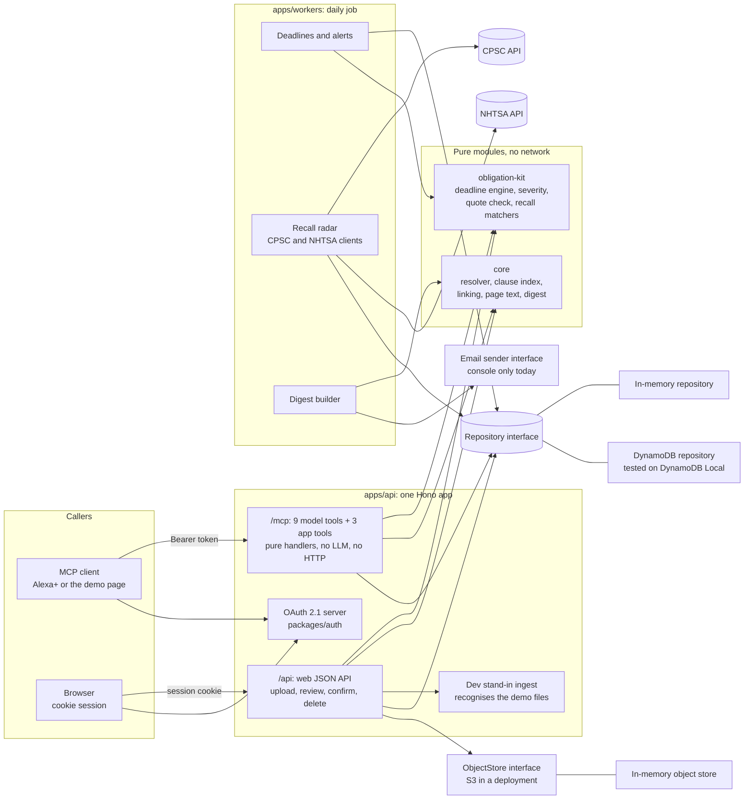

# Architecture

Hippo turns a household's paperwork (warranties, insurance, a lease, subscriptions) into dated obligations that a person has confirmed. It answers "am I covered?" from the document text, with the page cited. A daily job watches deadlines and recalls while nobody is talking.

This file describes the repo as it is today. Anything not built is listed in [What is not built or not proven](#what-is-not-built-or-not-proven). Decision numbers (D-nnn) and gotchas (G-nnn) refer to the team's private working log, which is not part of this repository.

## Components and data flow

**Tested only locally.** Every box above runs on a developer machine. DynamoDB is exercised on DynamoDB Local (CI runs it as a service container). S3, SES, Bedrock, Textract, Lambda and the CDK stack in `infra/` have never been called or deployed from this repo. See [AWS services](#aws-services-what-is-real-what-is-not).

### The nine model tools and three app tools

Model tools: `whats_coming_up`, `check_coverage`, `ask_documents`, `get_agreement`, `add_record`, `log_service`, `get_history`, `resolve_alert`, `undo_last`. App tools (buttons on cards): `ui_resolve_alert`, `ui_show_clause`, `ui_show_claim_steps`. Input schemas are in `packages/core/src/contracts/tools.ts`. None has a place for a household id.

### Moment 1: upload to deadline

1. The browser announces a file (`POST /api/uploads`), then sends the bytes. Type (PDF, JPEG, PNG), size (15 MB) and the file's first bytes are checked.
2. A reader turns it into an Agreement with every field marked `extracted`, none confirmed. Today the reader is a dev stand-in that recognises the demo files byte for byte and fails any other file with a plain reason. Starting the server with `HIPPO_INGEST=pipeline` swaps the stand-in for the real pipeline in `apps/workers/src/ingest`: page text extraction, classification, an injected extractor, the quote check, and the save. The extractor and the picture reader are fixture stand-ins by default; the Bedrock and Textract adapters only run with `HIPPO_LIVE_AI=1` and a model id, and have never been run against AWS.
3. The review screen shows each value with its quote and page. The person confirms or edits. Only then does the deadline engine give an obligation a severity, and only then can an alert exist.

The review screen is the React web app in `apps/web`. The same steps are available over the JSON API (see `docs/WEB_API.md`).

### Moment 2: coverage check

`check_coverage` takes the asset phrase ("dishwasher"), resolves it to one asset or asks which one, finds its warranty or policy, checks the term against today, and pulls the best coverage clause and any exclusion from the clause index. It returns clause text with document and page, claim steps, and a claim-by date. Alexa+ writes the spoken answer from that. The tool never says a claim will be approved.

### Moment 3: proactive catch

The first tool result of the day carries one extra sentence (for the demo, "Before that, your car insurance renews in 9 days."). It is built from open, high severity alerts only. Priority is renewals, expiries and notice-by dates, then recalls, then the rest. At most one sentence per household per day (D-042). The daily job in `apps/workers` is what raises deadline and recall alerts and builds the email digest.

## Why the voice path has no LLM and no outbound HTTP

INTENT principle 3: the voice path is fast and dumb. All reading happens at upload time. A round trip has to stay under 500 ms, and a model call or a third party call inside a tool would break that and add a way for document text to steer behavior.

What enforces it today:

- `apps/api/test/purity.test.ts` scans every file under `apps/api/src/mcp` and fails on imports of Node network modules, `fs`, `@aws-sdk/*`, pdf.js, anything matching bedrock or textract, HTTP client libraries, LLM SDKs, the recall network clients, the DynamoDB repository and dynamic `import()` or `require()`.
- The same test scans the 12 tool files and fails on `fetch(`, `XMLHttpRequest`, `WebSocket`, `Date.now`, `new Date()` with no argument, `Math.random`, `crypto` random calls, `process.env` and `performance.now`. So handlers are pure functions of the context and the arguments.
- Handlers reach data only through the injected `Repository` and the clause index cache. The recall clients are imported only by the daily job, by deep path, and a test in `apps/workers` checks that.

Honest limits: this is a static text scan, not a sandbox. It would not catch a determined workaround such as a call hidden behind a helper outside `apps/api/src/mcp`. In a deployment the repository itself talks to DynamoDB, which is network I/O to AWS, not to a third party.

## Confirm before alert

No alert comes from a date a model extracted until a person confirms it (INTENT principle 2, D-006). Where it is enforced:

- `severityFor` in `packages/obligation-kit/src/severity.ts` returns `null` when `confirmed` is false. An obligation is `confirmed` only when every source field it reads is `confirmed` or `edited`.
- `syncObligations` in `apps/api/src/obligations.ts` raises an alert only for an obligation that is confirmed and has a severity. The daily job (`apps/workers/src/daily/deadlines.ts`) uses the same rule and the same alert ids, so the voice path and the job never make two alerts for one obligation.
- `POST /api/agreements/<id>/confirm` marks exactly the named fields confirmed. `PATCH` counts as a confirmation by the person. Tests: `apps/api/test/webApi.review.test.ts`.
- Editing a date closes the old alert (marked `closedBy: stale`) so a date that no longer exists does not nag (D-047, D-049).
- Rent never gets a severity (D-020).

## Source quote verification

`verifySourceRefs` (`packages/obligation-kit/src/sourceRefs.ts`) is the guard against invented values. Every extracted value carries `{page, quote}`. The quote must appear on that page after folding case, spacing, hyphenation, quote marks and ligatures. A field that fails is dropped (a nested field becomes null, a list item is removed). Digits get a boundary check, so `12/3/2024` does not pass for `1/23/2024` and `30 days` does not pass inside `130 days` (D-025). OCR pages allow 5 percent edit distance on quotes of 20 or more characters, digits excluded. Rejections report the path and reason, never the quote, so no document text reaches logs.

What it proves: the quoted words are on the cited page. What it does not prove (D-025, D-031):

- That the value reads the quote correctly. The strict zod schemas and the human confirmation cover that.
- On OCR pages, a dropped "not" or a changed number word ("sixty" for "thirty") can still pass at 5 percent tolerance.
- A quote that starts mid-sentence is still on the page.
- It throws on cyclic input (model JSON is acyclic).

`verifySourceRefs` runs in the ingest pipeline (`apps/workers/src/ingest`), so every stored quote has been found on its cited page. Stored quotes are then masked to the last 4 digits.

## Retrieval

Document questions are answered by an in-process clause index, `packages/core/src/retrieval`, built on MiniSearch 7.2.0 (D-039). Documents are split into clauses of about 120 words at section headings, ALL CAPS lines, colon-ended lines and blank lines, with page numbers kept. Matching uses light stemming, a heading boost, prefix matching from 4 letters, no fuzzy matching, and one synonym table (leak, water damage, flood; break the lease, early termination; cancel; renew; claim; deductible). Scores below 2.25 return nothing, so an off-topic question gets "nothing relevant" instead of a guess. That cutoff was tuned on 17 fixture chunks. Scores depend on corpus size (G-028), so it is conservative for larger households.

Caching: the index is serialized per household. `createIndexCache` (`apps/api/src/mcp/indexCache.ts`) keeps it in memory keyed by household and an index version made from each active document's chunk metadata, and reloads only when the version changes. Today the only index source is in memory. The S3 source described in SPEC section 2 is not built.

Numbers recorded in the private working log (D-039, D-042):

| Measurement | Result | Conditions |
| :--- | :--- | :--- |
| Load a 2000 chunk index | 21.6 ms median | idle machine |
| Search 2000 chunks | 2.05 ms median | idle machine |
| Same, under load | 60 to 107 ms load, 5 to 10 ms search | tests allow 200 and 10 ms |
| `pnpm test:latency` through the MCP server | p50 16.8 ms, p95 31.9 ms (agent run: p50 3.2, p95 4.8) | local, in-memory repository, loaded laptop |

These are local, in-process numbers. Nobody has measured a deployed Lambda or a real Alexa+ round trip.

## Recalls

The recall radar runs in the daily job only (`apps/workers/src/daily/recalls.ts`). Parsers and matchers are pure (`packages/obligation-kit/src/recalls`); the network clients are kept out of the package barrel.

- **CPSC `high`** only on a UPC match (12 to 14 digits, never all zero, 8 digit codes never), or on a structured Model equal to the asset model with the asset brand as a whole word in the same product Name. Description, importers, manufacturers and distributors can only support `possible`. The Title is never evidence, because record 26569 has a Title for a different recall (G-008).
- **`possible`** is brand plus a shared product name word. Possible recalls are never emailed.
- **NHTSA `high`** only on the canonical make, model and year. The data is not VIN specific, so the wording is always "may affect your car".
- **Why `high` is rare:** child product recalls almost never list a UPC or model. Of 594 CPSC recalls in a 12 month scan, 18 had either, and only one was a child product (D-016). That is why the demo uses the Boon bottle recall 26530. Rare `high` is the point: INTENT principle 2 prefers asking over a false alarm.
- **Failures are loud.** The CPSC API reports a database failure as HTTP 200 with one fake record (G-012), and its UPC filter returned an empty list for a UPC that exists (G-013). The code throws on the fake record, on a result at the 2000 record ceiling and on an NHTSA Count that disagrees with its results, so a broken API never reads as "no recalls". Existing recall alerts are left untouched on failure.
- Live CPSC and NHTSA calls from the daily job are not verified; the dry run uses recorded responses. The live parsers were written against real saved responses.

## AWS services: what is real, what is not

| Service | State |
| :--- | :--- |
| DynamoDB | Used by code through the `Repository` interface (`packages/core/src/repository/dynamo.ts`). The 271 case shared suite passes on DynamoDB Local, run in CI. Never run against real AWS DynamoDB (D-048). Local differs from the service on index consistency, throttling, the 400 KB item limit and TTL deletion. |
| S3 | Modelled by the `ObjectStore` and `Uploader` interfaces. The only implementation is in memory. The presigned URL code is not written. |
| KMS, Lambda (with Function URLs), EventBridge, SSM, IAM, CloudWatch Logs | Defined in the CDK stack (`infra/src/hippo-stack.ts`). The stack synthesizes and 25 tests check the template. **It has never been deployed and no AWS call has been made from it** (D-037). Lambda handlers in the stack are placeholders that return 501. |
| SES | The stack grants `ses:SendEmail`. The digest builder is done and sends through an injected sender; the only sender is a console sender. An SES sender exists (`apps/workers/src/daily/ses.ts`) and is off by default; it needs `--send-ses`, `--yes-really` and a verified sender, and has only been tested against a fake client (D-045). |
| Bedrock, Textract | Granted in the stack's ingest role. No code calls either. Page text extraction has an OCR interface with no implementation. No model id is chosen. |

Fixture mode: documents, expected extractions and recorded CPSC and NHTSA responses live in `fixtures/`. AWS credits ran out before this project started (G-025), so any live AWS call needs an explicit yes from the team.

## OAuth 2.1 for Alexa+

One authorization server lives in the same Hono app (`packages/auth`, Hono and jose). Rules it follows, each with tests (306 in the package):

- Authorization code with PKCE `S256` only. The `plain` method is refused.
- The `resource` parameter is required on authorize and token, and must match the MCP URL (a trailing slash is tolerated). Tokens are bound to it as audience.
- Protected resource metadata at `/.well-known/oauth-protected-resource`, authorization server metadata at `/.well-known/oauth-authorization-server`.
- One pre-registered client, exact `redirect_uri` match, no dynamic client registration, no OIDC.
- A rejected `/mcp` call returns a bare 401 with no `WWW-Authenticate` header. The Alexa+ checklist requires that, which differs from the generic MCP spec (G-003). The MCP SDK's own bearer helper always adds the header (G-017), so `apps/api` has its own check.
- Refresh tokens are issued with every user access token and rotate. Reuse of a used code or refresh token revokes the whole family.
- A `client_credentials` grant (scope `mcp:service`) exists because the Alexa docs show it (G-018). Its tokens carry no household and can only `initialize` and `tools/list`.
- The household id comes only from the verified token, never from tool arguments.

Unverified: whether a real Alexa+ client accepts all this. No such client is available to us.

## Constraints we found

- Alexa+ developer tools (CLI, Local Inspector, Web Simulator) are for select partners only and cannot be applied for. K's attempt got `AccessDenied` (G-019, G-024, D-035). So the demo surface is a web page acting as a real MCP client (initialize, tools/list, tools/call over Streamable HTTP) against our server. The page is `/ask` in `apps/web`. It signs in with OAuth and PKCE, calls the tools through the official SDK client, and draws the Coverage, Coming Up and Recall cards from the tool result as plain React (not the MCP Apps host bridge). `pnpm --filter @hippo/api demo` does the same walk from a terminal.
- No documented push API for add-ons. Reminders arrive at the next interaction or in the daily email, not as device push (G-006).
- Alexa+ may initialize with protocol 2025-03-26 while the docs say 2025-11-25 (Q-010), so the server has to negotiate down.
- Lambda Function URLs created since late 2025 need both `lambda:InvokeFunctionUrl` and `lambda:InvokeFunction` (G-022). The stack grants both and a test proves it.

## What is not built or not proven

- **No deployment.** No Lambda, S3 bucket, table or email has been created. Nothing is hosted.
- **Live reading is off by default and unproven.** The ingest pipeline is built and runs in fixture mode, so only the demo files are readable. The Bedrock and Textract adapters exist (`HIPPO_LIVE_AI=1`, with a required model id and a required daily call cap) and have only run against fake clients. A real Bedrock call and a real Textract call were tried on 2026-10-21 and AWS refused both for account reasons (a zero daily token quota, and Textract not activated; private log G-047 and G-048). After the account moved to the paid plan, one Textract call through the AWS CLI read the warranty photo fixture (1 page, 15 lines), but our Textract adapter has never run live and no Bedrock call has ever succeeded, so no document extraction has run live.
- **One email has been sent.** The SES adapter (`--send-ses --yes-really`) sent one real digest on 2026-10-21 from a sandbox account to the developer's verified address, using `HIPPO_DIGEST_TO` to replace the placeholder recipient. Tests use a fake client. The digest is otherwise built and printed.
- **No real Alexa+ client** has talked to the server (D-035). How Alexa+ treats `structuredContent` versus `content` is unverified.
- **No presigned S3 upload**, and the clause index has no S3 source.
- **Auth state is in memory.** Codes, sessions and refresh tokens are lost on restart; a DynamoDB auth store is not built (D-040). Magic codes are printed to the server log in the demo because there is no mailer.
- **Live CPSC and NHTSA** calls from the daily job were not run. A first run alerts on all four Honda CR-V NHTSA campaigns and can crowd the digest (G-037, Q-012).
- **Real AWS DynamoDB** has never been used, so eventual consistency on the open alerts index is untested (D-038, D-048).
- **OCR** has never run on the phone-photo fixture.
- **MCP Apps cards** (Coming Up, Coverage, Recall) are not started. Every tool also returns full meaning as text.
- **Latency** is measured locally only.
- Retrieval is keyword based. A question that shares no words or synonyms with the clause finds nothing.
- Page text extraction fails closed and refuses some real PDFs (incrementally saved, some encrypted). Re-saving the file works around it (D-031).
